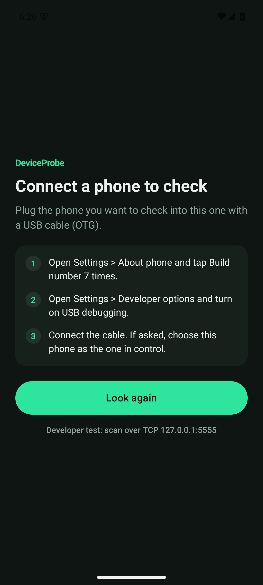
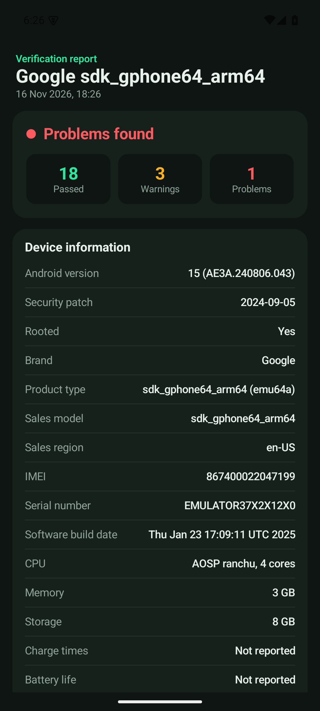
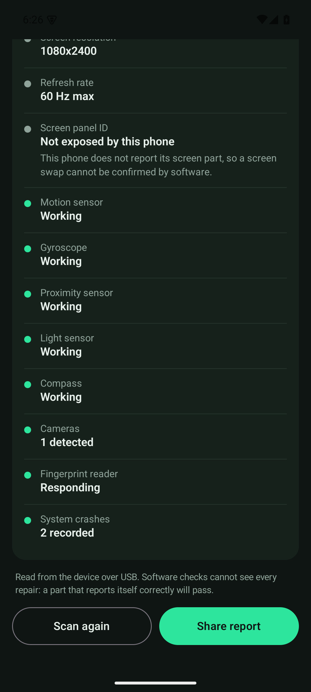

# DeviceProbe

**Check a used phone before you buy it, using only another Android phone and a USB cable.**

DeviceProbe is an Android app that connects to another phone over USB-OTG. It reads the phone's own hardware and system records and tells you, in plain language, whether the battery, screen and parts are original, whether it is locked to someone else's account, and whether it has been rooted or tampered with. It then gives you a shareable PDF report.

It's built for buyers at a second-hand market, phone-repair shops and resellers: people who need a verification report without a laptop.

<p>
  
  
  
</p>

[Sample PDF report](screens/sample-report.pdf) (made on an emulator)

## What it checks

| Area | Checks |
|---|---|
| **Identity** | Model, sales model, chipset, IMEI, firmware identity, Android version, security patch, build type (official release-keys or not) |
| **Battery** | Health, charge cycles, design vs. measured capacity, manufacture date, first-use date, and whether the battery was likely replaced (battery date vs. factory calibration date) |
| **Screen and parts** | Original vs. replaced screen (panel ID), refresh rate, cameras, fingerprint reader, proximity, light, motion, gyroscope and compass sensors |
| **Locks and security** | Google account lock (FRP), company management (MDM / Device Owner), root, bootloader state, SELinux, Samsung Knox |
| **Authenticity** | Genuine device vs. emulator or clone, and whether the reported model matches the hardware |

Each check is marked **passed**, **warning** or **problem**, with a one-line reason. A check that software alone can't confirm says so instead of guessing.

### iPhone and iPad (experimental)

DeviceProbe has its own implementation of Apple's usbmux and lockdown protocols (pairing, TLS, `diagnostics_relay`). It reads device info and battery health from an iPhone over the same cable. This passes unit tests against a simulated iPhone but **has not yet been tested on a real device**.

## How it works

- **Android:** a from-scratch ADB client (`adb/`) that speaks the ADB protocol over USB-OTG or TCP, with its own RSA key pairing. It runs `getprop`, `dumpsys` and `/sys` reads on the target phone, the same data a laptop with `adb` would see. No app is installed on the phone being checked.
- **iOS:** usbmux framing, lockdown pairing with self-generated certificates, and a binary/XML plist parser (`ios/`).
- **Report:** `DeviceInspector.kt` turns raw values into verdicts. `PdfReport.kt` renders the PDF with Android's own `PdfDocument`, with no third-party libraries.

Vendor quirks are handled where they matter. For example, Samsung prints battery values in brackets (`mSavedBatteryAsoc: [100]`), and Samsung's `ril.rfcal_date` is used as the factory date for battery-swap detection.

## Use it

1. Install the APK from [Releases](../../releases) on **your** phone (the checker).
2. On the phone being checked: Settings → About → tap **Build number** 7 times, then turn on **USB debugging** in Developer options.
3. Connect the two phones with a USB-C to USB-C cable (or an OTG adapter). The checking phone must be the host.
4. Tap **Allow** on the "Allow USB debugging?" prompt on the checked phone.
5. Wait about 20 seconds for the report, then share the PDF.

## Build

Requirements: JDK 17 and the Android SDK (platform 35).

```bash
./gradlew :app:assembleDebug
```

Run the tests, including the simulated-iPhone protocol tests:

```bash
./gradlew :app:testDebugUnitTest
```

Debug builds include a **Developer test** button that scans the device it runs on over `127.0.0.1:5555`. This is handy with an emulator, or a phone after `adb tcpip 5555`.

## Status

| | |
|---|---|
| Android, scan over TCP | ✅ Verified on an emulator (Android 15) and a Samsung Galaxy S24 Ultra |
| Android, phone-to-phone USB cable | 🟡 Implemented, not yet verified end to end |
| iPhone / iPad | 🟡 Protocol implemented and unit-tested, not yet tried on hardware |
| Play Store | ❌ Not published (Play restricts apps that use USB debugging), so install by sideloading |

## Privacy

Everything runs on the checking phone. No data leaves the device unless you share the PDF yourself. There are no accounts, no analytics and no network calls.

## Limits

- Software can only see what the phone reports. A well-done part swap with the original part's ID can't be detected, and the report says when a result can't be confirmed.
- The checked phone must have USB debugging turned on, so it needs to be unlocked by its owner.
- Some values (battery cycles, panel ID) are only exposed by certain manufacturers.

## Contributing

Issues and pull requests are welcome, especially device-specific fixes. If a check reads wrong on your phone, open an issue with the model and the relevant `dumpsys battery` / `getprop` lines (remove your IMEI and serial first).

## License

[PolyForm Noncommercial 1.0.0](LICENSE). It's free for personal use, learning and non-commercial use. For commercial use, such as in a repair shop's paid service or in another product, contact work@rvastudio.in.
